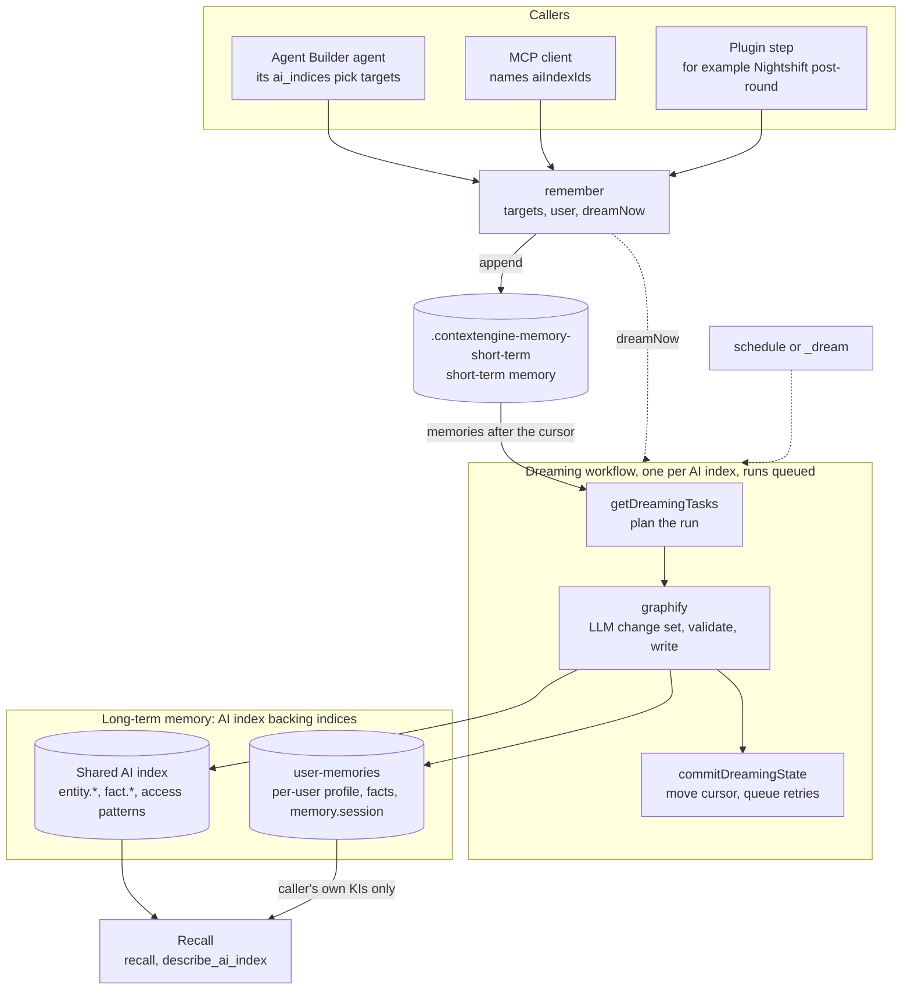
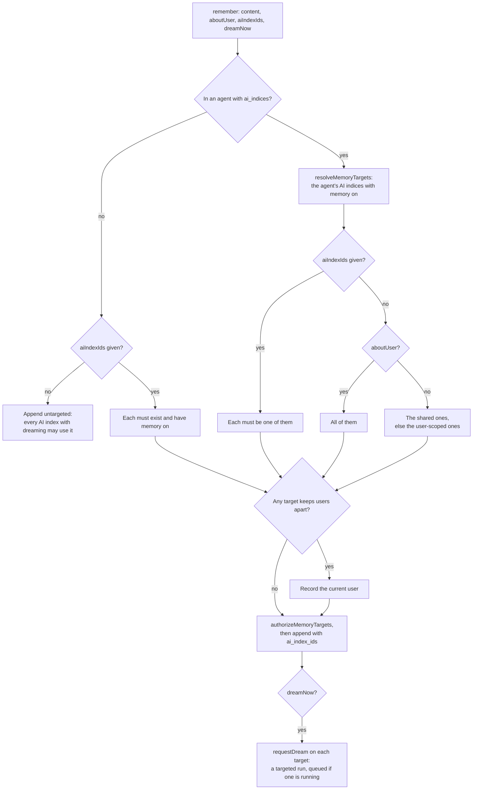
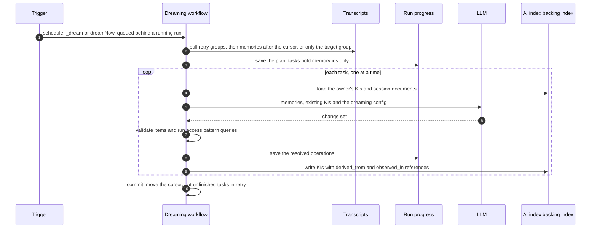
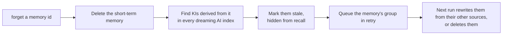
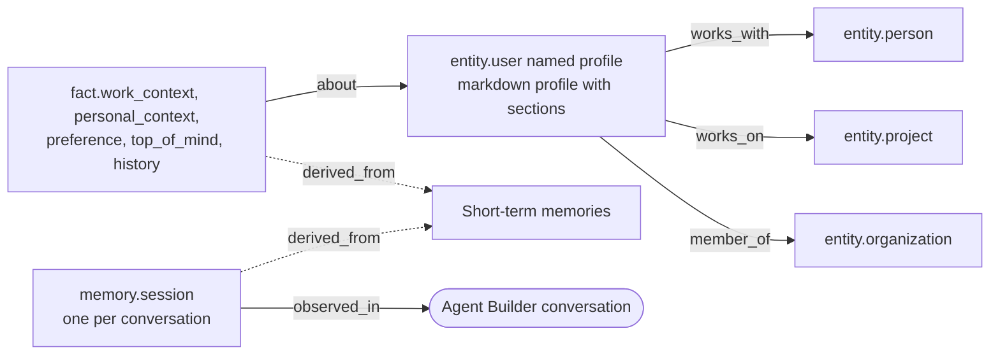
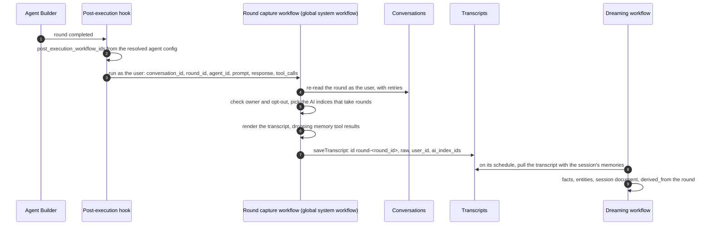

# Context Engine memory: short-term memory and dreaming

Status: draft

## Overview

Memory has two tiers.

- **Short-term memory** is one shared data stream for all AI indices. `_remember` appends raw
  session memories to it. A memory can name the AI indices it's for; otherwise any AI index with
  dreaming on may use it.
- **Transcripts** are a second data stream, kept apart from short-term memory: the verbatim
  transcript of a conversation round, with its `session_id`, saved through `saveTranscript`. Each
  names the AI indices it is for: every AI index that takes conversation rounds.
- **Long-term memory** is the existing backing index of each AI index (for example
  `ai-index-idx-ops-memory`). It holds the facts, entities, and relationships that dreaming
  produces.

Each AI index with dreaming turned on runs a managed workflow. The workflow pulls every
short-term memory and transcript in its space written after that AI index's cursor, as one stream
in cursor order, and turns them into long-term knowledge. AI indices dream independently of each other: the same short-term memory can be
dreamed by several AI indices, each tracking its own progress.

### What this branch adds

- **Short-term memory and dreaming:** `remember` and `forget`, the short-term data stream, and a
  managed dreaming workflow per AI index that turns memories into typed entities, facts,
  relationships and verified ES|QL access patterns.
- **Targeting and dream now:** a memory names the AI indices it's for, and `dreamNow` dreams it
  straight away. Runs queue instead of being dropped. See
  [Targeting and dream now](#targeting-and-dream-now).
- **Agent Builder agents write to and recall from their own AI indices:** `remember` routes each
  memory to the agent's AI indices that have memory on, and `recall` searches them. See
  [Agent Builder agents and user memories](#agent-builder-agents-and-user-memories).
- **User memories:** a `user-memories` AI index registered in every space and given to every
  agent, with a per-agent Memory setting to switch it off (the `elastic` AI index gets a
  checkbox too). It
  keeps each user's memory apart, and keeps a profile like Claude's memory plus one session
  document per conversation.
- **Plugin-registered dreaming config:** a plugin ships the dreaming config with its managed AI
  index; an admin only turns it on.
- **UI:** a Settings tab on each AI index shows its dreaming config and state as JSON, and
  creating an AI index starts with a two-step template setup: pick an example, then review its
  suggested ontology. See [UI](#ui).
- **Transcripts:** a separate `.contextengine-memory-transcripts` stream, written by
  `saveTranscript`. A short-term memory carries `content` only. See [Transcripts](#transcripts).
- **Memory API:** `remember`, `recall` and `saveTranscript` are Context Engine start contract
  methods and public routes (`POST /api/context_engine/_remember`, `_recall`,
  `_save_transcript`). The Agent Builder tools call the contract; `recall` also takes ES|QL, which
  replaces the `query_ai_indices` tool. See [Memory API](#memory-api).

- **Round capture:** agents that have an AI index or remember users save each completed round's
  transcript through a global system post-execution workflow. Rounds are on by default for every
  AI index with memory and dreaming on, shared ones included; `rounds: false` opts one out. See
  [Round capture](#round-capture).
- **Decisions:** what was decided while building this, and why, is in [Decisions](#decisions).

## Architecture

### Overview

Callers write short-term memories through `remember`. Each AI index's dreaming workflow turns the
memories meant for it into long-term knowledge in its backing index, and agents recall from
there.



### Where a memory goes

`remember` picks the memory's AI indices, records the user when a target keeps users apart, and
appends it. See [Agents write to their own AI indices](#agents-write-to-their-own-ai-indices).



### A dreaming run

One run of one AI index. Workflow state only ever holds ids and counts; memory content stays in
short-term memory and the run-progress index.



### Forget



### What user-memories holds for one user

Every id starts with the user's id, so reads can keep each user to their own. Every KI cites the
memories it came from.



## Short-term memory data stream

Name: `.contextengine-memory-short-term`. The data stream is hidden and owned by Context Engine.
Users never read or write it directly.

| Field | Type | Notes |
| --- | --- | --- |
| `@timestamp` | date | The server sets it when `_remember` writes. The cursor sorts on it. |
| `id` | keyword | Memory id. Breaks ties in the cursor. |
| `space` | keyword | The space `_remember` was called in. |
| `session_id` | keyword | Required. |
| `user_id` | keyword | Optional. If missing, the memory goes to shared long-term memory. |
| `content` | semantic_text | What to remember, searchable. Required. |
| `attributes` | flattened | |
| `occurred_at` | date | Optional and set by the client. Never used for the cursor. |
| `ai_index_ids` | keyword | Optional. The AI indices that may dream the memory; missing means all of them. See [Targeting and dream now](#targeting-and-dream-now). |

Writes:

- `_remember` appends a memory as the internal user, after the existing Context Engine
  write-access checks. Short-term memory is append-only. A memory needs `content`.
- `forget` deletes a memory (see [Forget](#forget)).

The Agent Builder tools `platform.context_engine.remember` and `platform.context_engine.forget`
write through the plugin start contract (`getShortTermMemoryService`, `forgetMemory`):

- `remember` takes `content`, plus `sessionId` for MCP calls (Agent Builder uses the
  conversation id). With `aboutUser: true` it records the caller's profile uid (or username) as
  `user_id`; otherwise the memory is shared. It returns `{ id, sessionId }`. `aiIndexIds` and
  `dreamNow` are described in [Targeting and dream now](#targeting-and-dream-now).
- `forget` takes the memory `id`. It refuses to forget a memory recorded about another user.

Short-term memory is searched through `recall` with `scope: 'short-term'` (see [Recall](#recall)).
Transcripts are never searched.

### Transcripts

Name: `.contextengine-memory-transcripts`. A hidden data stream owned by Context Engine, kept apart
from short-term memory so transcripts never mix with what agents chose to remember. Only dreaming
reads it.

| Field | Type | Notes |
| --- | --- | --- |
| `@timestamp` | date | Set when the transcript is saved. The cursor sorts on it. |
| `id` | keyword | Transcript id, unique across short-term memory too (round capture uses `round-<round_id>`). Breaks ties in the cursor. |
| `session_id` | keyword | Required: the conversation the round belongs to. |
| `user_id` | keyword | Required: whose round it is. |
| `raw` | keyword, not indexed, no doc values | The transcript, verbatim. Kept in `_source` for dreaming only, so it can't be searched and has no length limit beyond the API's (65,536 characters, `MAX_TRANSCRIPT_LENGTH`). |
| `attributes` | flattened | Round capture sets `round_id`, `agent_id` and `tool_ids`. |
| `occurred_at` | date | Optional. Never used for the cursor. |
| `ai_index_ids` | keyword | Required and never empty: a transcript shows what its user can read, so it never goes to every AI index. |

`saveTranscript` is the only way in:

```ts
// ContextEnginePluginStart
saveTranscript(params: {
  spaceId: string,
  request: KibanaRequest,
  input: SaveTranscriptRequest,   // below; the user is always the request's
}): Promise<SaveTranscriptResponse>
```

It needs the Context Engine read privilege and memory on. It records the request's user (their
profile uid, else username), and checks, as that user, that they may write each AI index's backing store
(`authorizeMemoryTargets`), then that each AI index takes rounds: memory on,
dreaming on, `rounds` not `false` (`assertMemoryTargets` with `round: true`). A
taken id throws `TranscriptExistsError`; transcripts are append-only.

`POST /api/context_engine/_save_transcript` exposes it over HTTP:

```ts
// request
{ id?: string, session_id: string, raw: string, ai_index_ids: string[], occurred_at?: string,
  attributes?: Record<string, unknown> }
// response
{ id: string, ai_index_ids: string[] }   // id is `transcript-<uuid>` when not given
```

It answers 400 when memory is off or an AI index does not take rounds, 403 when the user cannot
write an AI index, and 409 when the id is taken.

Dreaming always reads both streams through one reader (`createDreamingMemoryReader`): there is no
setting to leave transcripts out. Each source is
pulled from the same cursor and page size, and the two pages are merged in cursor order and cut
to the page size; the next cursor is the last item kept. A transcript reaches the model as
`transcript`, a short-term memory as `content`. Forgetting an id deletes it from whichever stream
holds it. Transcripts are deleted 30 days after they are saved (`ROUND_RETENTION_MS`), a batch per
dreaming run.

## Dreaming config and state

Both live on the AI index document in `.contextengine-ai-indices`:

```ts
dreaming: {
  enabled: boolean,
  schedule,          // interval; defaults to daily
  group_by,          // 'session_id' (default) | 'user_id'
  instructions,
  facts,
  entities,
  relationships,
  sessions,          // keep one memory.session KI per session; see Session documents
  rounds,            // accept recorded conversation rounds; see Round capture
  state: {
    cursor?: { timestamp: string, memory_id: string },
    retry: Array<{ group_key: string, from: { timestamp: string, memory_id: string } }>, // bounded
    last_run?: { execution_id: string, status: string, completed_at?: string },
  },
}
```

Rules:

- The existing AI index metadata APIs never accept `dreaming.state`. Their schemas reject it.
  `writeDocument` copies the stored `dreaming.state` into every write, so an update built from a
  stale read can't bring back an old cursor. If the update gets a 409 conflict, it re-reads the
  document and retries once.
- The dreaming state API (below) and `forget` are the only writers of `dreaming.state`. Both do a
  partial update with optimistic concurrency.
- **Starting point.** When dreaming is turned on and the AI index has no cursor, the cursor is
  set to `{ timestamp: now, memory_id: '' }`. Dreaming never backfills by default. To backfill,
  move the cursor back explicitly with `reset: true`.

## APIs

### Configure dreaming

`PUT /api/context_engine/ai_index/{aiIndexId}/_dreaming`

Saves the config and reconciles the managed workflow, following the same pattern as
`feedback_analysis/schedule.ts`:

- Turning dreaming on installs the workflow and enables it with the caller's request. Runs then
  execute under an API key created from that request. Every save creates a new key, so the
  schedule always runs as whoever saved it last.
- Turning dreaming off uninstalls the workflow. `dreaming.state` is kept.
- The workflow is not added to the AI index's `automations` list.
- Saving fails if workflows management isn't available.

### Pull short-term memories

`POST /internal/context_engine/ai_index/{aiIndexId}/short_term_memory/_pull`

```ts
// request
{
  after?: { timestamp: string, memory_id: string },
  until: string,
  group_keys?: string[],                 // bounded maxSize
  size: number,                          // bounded, for example max 500
}
// response
{
  memories: ShortTermMemory[],
  next?: { timestamp: string, memory_id: string },
}
```

1. Authorize the caller: they need the Context Engine feature privilege, `memory_enabled` must be
   on, and `has_privileges` must confirm write access to the AI index's backing index.
2. Search as `asInternalUser`, filtered on `space` and on `(@timestamp, id)` being after `after`
   and up to `until`, on `group_keys` when set, and on `ai_index_ids` being missing or containing
   this AI index. Sort on `@timestamp` then `id`, and page with
   `search_after`.

The workflow steps call the same service function in-process.

### Update dreaming state

`PUT /api/context_engine/ai_index/{aiIndexId}/_dreaming/_state`

```ts
{
  execution_id: string,                  // must match the workflow execution in progress
  cursor: { timestamp: string, memory_id: string },
  retry: Array<{ group_key: string, from: { timestamp: string, memory_id: string } }>, // bounded maxSize
  reset?: boolean,                       // allow moving the cursor backwards
}
```

- The cursor can only move forward unless `reset: true` is set.
- A `reset` request without a run in progress needs the same privileges as saving the dreaming
  config.

### Explicit run

`POST /api/context_engine/ai_index/{aiIndexId}/_dream`

```ts
{ session_id?: string, user_id?: string, dry_run?: boolean }
```

This calls the workflow's `manual` trigger and returns `{ run_id: <execution id> }`. If a run is
already in progress, the new run waits for it (see [Queued runs](#queued-runs)). A targeted run
reads its group up to now, without the settle lag. It needs the Context Engine write privilege.

From Dev Tools Console, Kibana routes take the `kbn:` prefix; the route has one version, so the
version header can be left out:

```
POST kbn:/api/context_engine/ai_index/user-memories/_dream
{}
```

`remember` with `dream_now: true` and `ai_index_ids` stores a memory and starts this in one
call. The run's progress is in the workflow execution named by `run_id`
(`.workflows-executions`), and each `graphify` step's output counts what it created, updated
and rejected. Only a `dry_run` records why an item was rejected.

## Dreaming workflow

A new managed workflow definition sits next to the feedback analysis one in
`@kbn/workflows/managed/definitions/context_engine`.

```yaml
settings:
  timeout: '45m'
  concurrency:
    key: 'context-engine-dreaming-__AI_INDEX_ID__'
    strategy: queue
    max: 1
    queue-size: 20
    queue-ttl: '2h'
triggers:
  - type: scheduled
    with: { every: '__INTERVAL_MINUTES__m' }
  - type: manual
    inputs: { session_id, user_id, dry_run }     # '' means no target
steps:
  - name: plan_run
    type: context-engine.getDreamingTasks
  - name: run_tasks
    type: foreach
    foreach: '${{ steps.plan_run.output.tasks }}'
    iteration-on-failure: { continue: true }
    steps:
      - name: graphify
        type: context-engine.graphify
        on-failure: { retry: { max-attempts: 2, delay: '30s' } }
        with:
          task_id: '{{ foreach.item.task_id }}'
          dry_run: '${{ steps.plan_run.output.dry_run }}'
  - name: commit
    type: context-engine.commitDreamingState     # always runs; on dry_run it only closes the run
  - name: output_result
    type: workflow.output
```

The full definition is `kbn-workflows/managed/definitions/context_engine/dreaming.yaml`
(`system-context-engine-dreaming`).

### Maintaining the dreaming workflow

- **One template.** `dreaming.yaml` is the only copy of the workflow. `CONTEXT_ENGINE_DREAMING_WORKFLOW`
  in `definitions/context_engine/index.ts` registers it as a managed workflow with
  `lifecycle: 'dynamic'`, `versionStrategy: 'auto'` and `enablement: 'restorable'`. An instance
  fills in only `__AI_INDEX_ID__` and `__INTERVAL_MINUTES__`.
- **One instance per AI index and space.** Turning dreaming on (`PUT _dreaming`) installs
  `system-context-engine-dreaming-<aiIndexId>-<space hash>` with those values, then enables it
  with the caller's request (`dreaming/schedule.ts`). Turning it off uninstalls the instance.
  Instances aren't created when an AI index is registered: registration has no space and no
  request to run as.
- **How a change rolls out.** Edit `dreaming.yaml` and bump `version` in the same change. The
  managed workflow hash covers the `yamlTemplate` function, not the YAML it imports, so without the
  bump installed instances keep the old YAML. `managed_workflow_definitions.test.ts` fails until
  `version` and the YAML's expected fingerprint are updated together. On the next Kibana start, workflows management
  re-renders every instance in every space from its saved values. Enablement and the existing API
  key carry over, so no one has to turn dreaming on again. Changing the interval re-renders only
  that instance, on save.
- **What stays in TypeScript.** The YAML only orders the steps, and sets the schedule, concurrency,
  retries and timeout. The work is in the step types: `context-engine.getDreamingTasks`,
  `context-engine.graphify` and `context-engine.commitDreamingState`. Their input and output
  schemas are in `common/step_types/dreaming.ts`, and their handlers in
  `server/step_types/dreaming.ts`, which call `server/dreaming/` (planning, the prompt and model,
  validation, writing KIs, state). Changes there ship with Kibana and need no `version` bump,
  unless a step's inputs or outputs change, which means editing the YAML as well.
- **Why not one shared workflow that each instance calls.** A per-index wrapper calling a system
  workflow through `workflow.execute` would mean two executions per run, passing the API key to
  the child (`run-as-mode: inherit` with an allow list), and passing the manual inputs and outputs
  through. The template already reaches every instance with one `version` bump.

### Run progress

The run's plan and each task's progress live in the hidden index `.contextengine-dreaming-runs`,
keyed by space, AI index and execution id. Memory content never goes there; tasks hold memory ids,
and a task's saved plan holds the resolved operations. `commit` deletes the run's documents, along
with any older than 7 days.

### Steps

1. **`getDreamingTasks`**
   - Reads the config and state, and sets `until = now - settleLag`.
   - Pulls the memories written after the cursor, plus each `retry` group from its `from`
     position (or only the `_dream` target).
   - Groups them by user and `group_by`, splits groups over 200 memories, and saves the plan in
     run progress. It returns `{ tasks: [{ task_id, group_key, count }], dry_run }`, so workflow
     state holds ids and counts only.
   - Tasks are sorted by user, then by each group's first memory.
   - The run is capped at 2,000 memories. Anything over the cap stays after the cursor, or in
     `retry`, for the next run.
   - Records the execution as `last_run` on the dreaming state. A run already in progress (within
     the 45 minute timeout) makes the step fail.
2. **`graphify`** turns one task's memories into long-term graph changes, entirely inside the
   step:
   - **Load.** Pulls this task's memories, and the user's current long-term facts and entities
     (including any marked stale), with their ids. It reads fresh on every iteration, so each
     task sees what the previous task wrote.
   - **Extract.** Calls the LLM (see [Model](#model)) with the dreaming instructions and the
     configured fact, entity and relationship types. The result is a change set: an existing id
     overwrites, `delete: true` deletes, a new key creates. Irrelevant memories produce an empty
     change set. See [Change set](#change-set).
   - **Validate.** Rejects invalid items one by one, and runs every access pattern example
     through the ES|QL verifiers, dropping the ones that fail (see [Validation](#validation)).
   - **Persist the plan.** Saves the change set in the run-progress document, keyed by execution
     id and task, before writing anything. On a retry, it re-applies a saved plan instead of
     calling the LLM again, so a retry can't create duplicates.
   - **Apply.** Writes the change set with the workflow's scoped client through `ki_write.ts` and
     `ki_revision.ts`. Every KI created or updated gets a `derived_from` reference to the
     short-term memory ids it used, and `observed_in` the session. Provenance is
     `task://dreaming/default`, with `run_id` and `task_id` metadata.
   - **Record.** Marks the task as done in the run-progress document.
   - **Output.** Returns only ids and counts (`created`, `updated`, `deleted`, `rejected`,
     `access_patterns_dropped`), so memory content never enters workflow state. With `dry_run`,
     it returns the resolved operations, and why each rejected item was rejected
     (`rejections`), and doesn't write.
3. **`commitDreamingState`**
   - Moves the cursor to the last memory the plan read. A targeted run leaves the cursor alone.
   - Every task not recorded as done is written to `retry` at its `from` position. Retry entries
     consumed by the run are removed; entries queued during the run (by forget) are kept.
   - If `retry` is full, the cursor stays where it is and the run reports `partial` with a warning.
   - On a dry run, it only closes `last_run`, so the next run isn't blocked.

### Model

`graphify` uses the model configured for the existing Context Engine inference feature,
`context_engine`, in Model Management. The feature is registered in
`context_engine_agent_builder/server/register_inference_features.ts`. Neither the AI index nor
the dreaming config has its own model setting.

- Before each task, `graphify` resolves the model with
  `searchInferenceEndpoints.endpoints.getForFeature('context_engine', request)`, using the
  workflow's scoped request. It uses the first endpoint returned and calls it through the
  inference plugin's chat completion API.
- Resolution follows the existing chain: the admin override for `context_engine` first, then the
  global default. The feature registers no recommended endpoints and doesn't set
  `ignoreGlobalDefault`.
- If nothing resolves, the task fails with a clear error, and `commit` puts the group in `retry`.
- The model is resolved again for every task, so changing it in Model Management takes effect
  from the next task.
- `context_engine` gains `inference` as a required plugin and `searchInferenceEndpoints` as an
  optional plugin. Without `searchInferenceEndpoints`, turning dreaming on fails.

### Change set

The LLM only describes knowledge. `graphify` assigns the final ids, type prefixes, references
and provenance, and validates everything before it saves the plan.

#### What `graphify` sends the model

- The dreaming instructions, and the configured fact types, entity types (with their attribute
  keys) and relationship types (with their source and target entity types).
- The task's short-term memories and transcripts, each with its id: a memory's `content` (cut to
  4,000 characters), a transcript's `transcript` (cut to 16,000). A rule says a transcript records
  a round as it happened: take only what it states or shows, and never a fact only the agent's
  notes or answer support.
- The user's existing entities and facts, each with its id, type, current fields, and a `stale`
  flag.
- Rules that facts stand alone, naming the entities they are about and keeping exact values,
  because recall reads facts without their entities. Every fact lists the entities it is about in
  `about`, creating an entity of a configured type if none exists. The model should also link
  entities with the configured relationship types whenever the memories support it.
- A rule that every entity has a content summary of its attribute values and main facts, which
  the model rewrites whenever it creates, updates or deletes a fact about the entity.
- Rules for access patterns, taken from the `unit_profile` and `index_metadata` automation
  templates in `context_engine_agent_builder`. An entity or fact gets access patterns only when
  the memories show how to query the raw data about it, built from the indices, fields and
  queries in those memories and never invented. The ES|QL rules are the templates' rules: start
  with `FROM <index>`; use real field names, in backticks when they contain spaces; double-quote
  strings; count booleans with `COUNT(*) WHERE field == true`; use `AVG()` and `SUM()` only on
  numeric fields; and end the example with a small `LIMIT`. Existing items are shown with their
  content and access patterns as separate fields.

#### What the model returns

The model returns a structured output schema. The change set uses arrays rather than maps keyed
by id, because structured output modes handle arbitrary object keys and `null` poorly. The
semantics are the ones from the architecture doc: an existing id overwrites, `delete: true`
deletes, a new id creates. On an update, any field left out keeps its current value.

```ts
interface DreamingChangeSet {
  entities: Array<{
    ref: string;                 // an existing entity id, or a new key like "new:1"
    delete?: boolean;            // true deletes an existing entity
    type?: string;               // a configured entity type, without the "entity." prefix
    name?: string;
    description?: string;
    content?: string;            // a summary of what is known about the entity
    attributes?: Array<{ key: string; value: string }>; // configured keys only
    access_patterns?: AccessPattern[]; // replaces the current list; [] removes it
    source_memory_ids?: string[]; // short-term memory ids; required unless deleting
  }>;
  facts: Array<{
    ref: string;                 // an existing fact id, or a new key like "new:1"
    delete?: boolean;            // true deletes an existing fact
    type?: string;               // a configured fact type, without the "fact." prefix
    title?: string;
    content?: string;
    about?: string[];            // entity refs, existing or new; replaces the current list
    access_patterns?: AccessPattern[]; // replaces the current list; [] removes it
    source_memory_ids?: string[]; // short-term memory ids; required unless deleting
  }>;
  relationships: Array<{
    type: string;                // a configured relationship type
    source: string;              // entity ref
    target: string;              // entity ref
    remove?: boolean;            // true removes an existing relationship
    source_memory_ids?: string[]; // short-term memory ids
  }>;
  sessions: Array<{             // only when the config keeps session documents
    session_id: string;          // a session of this task
    title?: string;
    summary?: string;            // starts with the session date
  }>;
}

// The shape the automation templates use.
interface AccessPattern {
  question_type: string;         // a short label for the kind of question
  esql_template: string;         // ES|QL with named ?param placeholders
  esql_example: string;          // the template with real values and a small LIMIT
  returns: string;               // what the query returns
}
```

Anything the model leaves out stays unchanged. An empty change set is valid.

#### Validation

`graphify` checks each item on its own. An invalid item is dropped and counted in the step's
`rejected` output, and the rest of the change set still applies.

- Types must be configured. With no dreaming config, the defaults apply: one generic fact type
  `fact`, and any entity type.
- An entity attribute key must be configured for that entity type.
- A relationship's source and target must resolve to entities of the configured source and
  target types.
- A fact `ref` must be either an id loaded for this task or a new key defined in this change set.
  An entity `ref` that isn't a loaded id is treated as a new key, whatever its form: models often
  label new entities their own way (`person:anish_mathur`, `profile`), and an entity's id comes
  from its type and name, so this can't duplicate an entity. A delete is only valid for an id
  that was loaded.
- Every `source_memory_ids` entry must be one of this task's short-term memory ids or an existing
  source of the KI. Upserts must list at least one.
- Each list is capped at 200 items. Field lengths reuse the existing KI limits
  (`MAX_KI_TITLE_LENGTH`, `MAX_KI_CONTENT_LENGTH` and so on). An item has at most 5 access
  patterns, and each query is capped at 4096 characters.
- Every access pattern's `esql_example` runs through the `esql-valid-syntax` and
  `esql-valid-runtime` verifiers as the workflow user, so a pattern only cites data that user can
  read. A failing pattern is dropped and counted in the step's `access_patterns_dropped` output;
  its item still applies. If all of an item's new patterns fail, it keeps the ones it had. This
  check runs before the plan is saved, so a retried task doesn't run it again.

#### What `graphify` writes

Every write goes into the AI index's backing index, through `ki_write.ts` and `ki_revision.ts`.

**Entity:**
- **id:** `<user>/entity-<type>-<slug(name)>`. Because the id is deterministic, a new entity whose
  name matches an existing one resolves to it, so the model doesn't have to match names itself.
- **type:** `entity.<type>`.
- **title:** `name`. **description:** `description`.
- **content:** a summary of what is known about the entity, including its attribute values and
  the main facts about it. The model rewrites it whenever it changes a fact about the entity, so
  the entity can be found and read without its facts. An update that leaves it out keeps it.
- **attributes:** `memory.user_id`, plus each configured attribute under `entity.<key>`.

**Fact:**
- **id:** `<user>/fact-<hash(execution_id, task_id, ref)>`. The hash is computed once, when the
  plan is saved, so a retry writes the same id.
- **type:** `fact.<type>`.
- **title**, **content**, and **attributes:** `memory.user_id`.

**Access patterns**, on entities and facts, are written the way the automation templates write
them:

- **content:** gets an `## Access patterns` section after the summary, with one
  `- [question_type] returns` line per pattern followed by its template and example. Recall
  reads `content`, so this is what a later agent sees.
- **attributes:** `esql` holds every `esql_example`, which is the attribute the ES|QL verifiers
  check. `access_patterns` holds each pattern as JSON, so the next run can show the model what
  the item carries.

An update that leaves the patterns out keeps them. A new content summary keeps the patterns
section after it.

`fact.*` and `entity.*` are the dreamed KI types. Like the session memory types, both are left
out of ordinary KI retrieval and type counts, and are recalled through the memory queries that
`describe_ai_index` shows. That a KI came from dreaming is recorded by its `derived_from`
references, not by its type.

**References**, added on top of whatever the KI already has:

| Reference | `uri` | `relation` |
| --- | --- | --- |
| Source memory | `memory://<short-term memory id>` | `derived_from` |
| Session | `session://<session_id>` | `observed_in` |
| Fact about an entity | `ki://<entity id>` | `about` |
| Configured relationship, stored on the source entity | `ki://<target entity id>` | `relates_to`, with `type: <relationship type>` |

`derived_from` references accumulate across runs, so forget can find every KI that used a
memory. `remove: true` deletes the matching relationship reference from the source entity.

**Deletes** use the existing soft delete (`softDeleteKi`). Deleting an entity doesn't change
other KIs that reference it, because recall already filters out deleted KIs.

**Memories without a `user_id`** use `_shared` in place of `<user>` in ids, and have no
`memory.user_id` attribute.

#### Stale KIs after a forget

Before calling the model, `graphify` does the following with stale KIs:

1. Removes the `derived_from` reference to the forgotten memory.
2. Soft-deletes any KI left with no `derived_from` references, without involving the model.
3. Sends the rest to the model with `stale: true`.

After the change set is applied, any stale KI the model didn't touch is made `active` again and
is kept as it is. A KI the model rewrites becomes `active`; a relationship change alone leaves its
source entity's status as it was.

#### Changes to the KI schema

- Add a `stale` value to `governance.lifecycle.status` (`active | stale | deleted`). The lifecycle
  filter Context Engine adds to every ES|QL query on a registered AI index keeps only `active`
  (or missing) statuses, so recall leaves out stale KIs without any extra filter. A flattened
  `attributes` flag wouldn't work, because ES|QL can't filter on flattened subfields.
- Add `about` and `observed_in` to `KI_REFERENCE_RELATIONS`.
- Add an optional bounded keyword `type` to `kiReferenceSchema`, for configured relationship
  types.

#### Changes to the `ai-index@mappings` template (Elasticsearch)

The AI index backing mappings come from the `ai-index@mappings` component template, which is
defined in the Elasticsearch codebase, not in Kibana. Dreaming needs these from it:

- **`references.type`:** a new `keyword` field. Without it, configured relationship types are
  stored in `_source` but can't be searched or filtered.
- **`references.relation`:** must stay a plain `keyword`, so the new `about` and `observed_in`
  values index without a mapping change.
- **`governance.lifecycle.status`:** already a `keyword`, so `stale` needs no mapping change.

The Elasticsearch change ships separately. Until it lands, dreaming still works; only queries on
`references.type` don't.

#### Telemetry

The `context_engine` usage collector counts stale KIs as their own lifecycle bucket,
`kis.<user|managed>.stale.<total|max|min|avg>`, next to `active`, `expired` and `deleted`. A KI
that is stale and past its `expires_at` counts as stale.

### Ordering and late writes

- Tasks run one at a time. Two runs can't overlap because of the workflow's concurrency key.
- A memory that becomes searchable after `until` is still after the cursor, so the next run
  picks it up.
- Changing the config affects the next run. Memories that were already dreamed aren't processed
  again unless the cursor is reset.

## Forget

1. Find long-term KIs whose `derived_from` includes that memory id, across the space's AI indices
   that have dreaming turned on.
2. Set those KIs' lifecycle status to `stale`, as the user forgetting: AI index data belongs to
   users, and Kibana's own user can't write it on every deployment (serverless refuses it).
   Recall leaves out stale KIs.
3. Add the group to `retry` on every AI index that held one of those KIs, with `from` set to just
   before the forgotten memory.
4. Delete the short-term memory. It goes last, so a write that fails leaves the memory in place to
   be forgotten again, instead of KIs that cite a memory that no longer exists.

`forgetMemory(spaceId, memoryId, request)` on the start contract takes the request for step 2.

On the next run, that group's task gets the stale KIs and their remaining sources. It then
rewrites or deletes each one. A KI whose only source was the forgotten memory is deleted without
calling the model.

## Targeting and dream now

Two additions to `remember`:

- **Targeting.** Each memory entry can name the AI indices it applies to. An entry that names
  none applies to every AI index in the space, as before.
- **Dream now.** Starts dreaming right away instead of waiting for the schedule.

`remember` still only writes short-term memory, and it never changes an AI index's dreaming
config. Dream now is best-effort: a memory the immediate run misses is still after the cursor,
so the next scheduled run dreams it.

### Remember API

Targeting is part of the memory entry, so every way of writing a memory supports it: the
`remember` tool, MCP, and plugins that call `getShortTermMemoryService().remember` directly
(Nightshift's post-round step, for example).

```ts
// ShortTermMemoryServiceApi.remember(spaceId, entry)
interface ShortTermMemory {
  '@timestamp': string,
  id: string,
  session_id: string,
  user_id?: string,
  content: string,         // at most 65,536 characters (MAX_SHORT_TERM_CONTENT_LENGTH)
  attributes?: Record<string, unknown>,
  occurred_at?: string,
  ai_index_ids?: string[], // at most 20 (MAX_SHORT_TERM_AI_INDEX_IDS). Missing or empty: every AI index
}
```

The service runs as the internal user and has no request, so it checks only what it can see
alone (`assertMemoryTargets`): each target must exist in the space and have `memory_enabled` on.
It removes duplicate ids, and stores an empty list as a missing field.

The start contract has two methods for callers that have a request:

```ts
// Throws unless the user can write each target's backing index (the pull route's check).
// Call it before writing a memory with ai_index_ids.
authorizeMemoryTargets(params: {
  spaceId: string,
  aiIndexIds: readonly string[],
  request: KibanaRequest,
}): Promise<void>

// Starts a targeted run on each AI index, as the request's user.
requestDream(params: {
  spaceId: string,
  aiIndexIds: readonly string[],
  memory: Pick<ShortTermMemory, 'session_id' | 'user_id'>, // picks each AI index's target group
  request: KibanaRequest,
}): Promise<DreamRequestResult[]>   // the `dreams` entries below
```

The `remember` tool maps its inputs onto the entry:

```ts
// platform.context_engine.remember
{
  content: string,
  sessionId?: string,
  aboutUser?: boolean,
  aiIndexIds?: string[],   // becomes ai_index_ids on the entry
  dreamNow?: boolean,      // requires aiIndexIds
}
// result
{
  id: string,
  sessionId: string,
  dreams?: Array<{          // only with dreamNow
    aiIndexId: string,
    status: 'started' | 'skipped',
    runId?: string,        // when started; it may wait for a run already in progress
    reason?: string,       // when skipped, for example dreaming is off
  }>,
}
```

The tool calls `authorizeMemoryTargets`, then writes the memory, then calls `requestDream`. If a
target is refused, nothing is written. `dreamNow` without `aiIndexIds` is an error. The tool
description tells the agent to set `dreamNow` only on its last `remember` of a session, because
each run dreams the memory's whole group.

### Targeting

- The short-term memory data stream has an optional `ai_index_ids` keyword field (data stream
  version 2, which adds the field to the existing write index).
- Every short-term memory read for an AI index keeps memories where `ai_index_ids` is missing, or
  contains this AI index. This covers the pull route, cursor ranges, `retry` ranges and targeted
  runs.
- Memories meant for other AI indices never hold the cursor back. The cursor moves to the last
  memory this AI index read, and later reads skip the others again.
- A target that later turns dreaming off, or is deleted, just never dreams the memory. Other
  targets are unaffected.
- Targeting doesn't change forget. Forget finds KIs by their `derived_from` references.

### Starting a run

For each target, `requestDream` works as follows:

1. It checks that the user can write the AI index's backing index, and that dreaming is on. If
   not, it reports `skipped` with the reason. The memory is already written.
2. It picks the run's target from the AI index's `group_by`: the memory's `session_id`, or its
   `user_id` (the shared group when the memory has none).
3. It starts a targeted run through the workflow's `manual` trigger, as the caller, the same way
   `_dream` does, and reports `started` with the run id.

`remember` doesn't wait for a run to finish.

### Queued runs

The dreaming workflow's concurrency strategy is `queue` (`max: 1`, `queue-size: 20`,
`queue-ttl: 2h`), not `drop`. A run requested while another run of the same AI index is in
progress waits for it, then runs with its own request's credentials. This applies to dream now,
`_dream` and the schedule alike. So there is no pending list and no follow-up task: the workflow
engine keeps the backlog. A request that falls off a full queue is skipped by the engine. Its
memories are still after the cursor, so the next scheduled run dreams them.

A queued run starts only after the previous execution has finished, so `getDreamingTasks` never
sees `last_run` still running. `_dream` no longer returns 409.

### Settle lag

Targeted runs read up to `now`. `remember` writes with `refresh: 'wait_for'`, so a memory is
searchable before `remember` returns, and an immediate run would otherwise skip the memory it
was started for. The 30 second settle lag still applies to cursor and `retry` ranges, which it
protects from writes that become visible late.

### Re-dreaming

An immediate run doesn't move the cursor, so the next scheduled run reads the same memories
again. `graphify` already skips memories that a KI in the AI index cites through `derived_from`,
so this writes no duplicate facts. A memory that produced no KI isn't cited, so the model sees it
one more time.

To dream memories the cursor has already passed, for example after changing an AI index's
dreaming template, move the cursor back with `PUT _dreaming/_state`
(`{ reset: true, cursor: { timestamp, memory_id: '' }, retry: [] }`), then start a run. KIs made
under the old config stay unless they are deleted first: a fact type the new config doesn't define
is not rewritten, so to rebuild an AI index from scratch, delete its KIs, reset the cursor to the
AI index's creation time, and dream.

### Trade-offs

- **Credentials.** An immediate run executes as the caller, not as whoever saved the dreaming
  config. The write-access check on every target keeps a caller from starting a run on an AI
  index they can't write.
- **Cost.** Each immediate run calls the model for the group's new memories and reloads the
  owner's KIs. A caller that sets `dreamNow` on every `remember` pays for one run per call, up to
  the queue size. No per-AI-index rate limit is set yet (see [Open questions](#open-questions)).

### Testing

- **Unit tests** cover:
  - target checks in the service (`short_term_memory/service.test.ts`), the start contract and
    the `remember` tool (`dreaming/request_dream.test.ts`, `remember/tool.test.ts`)
  - an empty list stored as missing, and duplicate targets removed
  - the `ai_index_ids` filter on cursor, `retry` and targeted reads (`plan_run.test.ts`)
  - `started` and `skipped` results, and the run target picked by `group_by`
  - `until = now` for targeted reads
- **Harness:** the targeted variant is described in [Testing](#testing).

## Agent Builder agents and user memories

### Agents write to their own AI indices

An Agent Builder agent's effective `ai_indices` (its own plus the ones its type inherits) are
recorded on its entry in the run context (`RunAgentStackEntry.aiIndices`), so tools can read
them. In a conversation, the `remember` tool picks the memory's targets from them:

1. `resolveMemoryTargets` (start contract) keeps the agent's AI indices that exist and have
   memory on, with each one's `memory_scope`.
2. With `aiIndexIds`, the memory goes to those, which must be among the agent's memory AI indices.
3. Otherwise a memory about the user (`aboutUser`) goes to all of them, and any other memory goes
   to the shared ones, or to the user-scoped ones when the agent has nothing else.
4. A memory that goes to a user-scoped AI index always records the current user.

Outside an agent (MCP, or an agent with no `ai_indices`), `aiIndexIds` works as before, and a
memory without it stays untargeted. The result reports the `aiIndexIds` the memory went to.

The agent prompt's AI INDICES catalog marks AI indices that take memories, and tells the agent to
record what a later conversation would need with `remember`. Memory tools are offered as before:
when any of the agent's AI indices has memory on.

### Built-in AI indices: elastic and user-memories

Two AI indices are built in, and each has its own switch on the agent's configuration. Unset
means on, so existing agents, including the Elastic AI Agent, get both without any change:

| AI index | Switch | Applies to |
|---|---|---|
| `elastic` | `enable_elastic_ai_index` | Agents whose type provides it (chat agents) |
| `user-memories` | `enable_user_memory` | Every agent |

- **Effective AI indices.** `applyBuiltinAiIndexSwitches` (`@kbn/agent-builder-server/agents`)
  runs after the type's base configuration is merged with the agent's own. It adds
  `user-memories`, and drops each built-in AI index whose switch is `false`, even one the agent
  also lists in `ai_indices`. The run context, the prompt catalog and `remember` all see the
  result. A type's base configuration can set either switch, and the agent's own
  value wins.
- **API.** Both flags are optional booleans on agent create and update. The
  `GET /internal/agent_builder/agents/{id}/_ai_indices` listing marks `user-memories` as a
  default, and leaves out a built-in AI index that is switched off.
- **UI.** User memory is its own Memory section in the agent's settings, both on the settings
  tab and in the edit details flyout, with a Remember users switch. It isn't presented as an AI
  index: `user-memories` isn't listed in the AI indices section or offered in its picker. The AI
  indices section shows `elastic` as a checkbox under Default indices, only for agents whose type
  provides it; other type-contributed indices stay as fixed badges.
- **The shared id.** `agentBuilderUserMemoriesAiIndexId` (`@kbn/agent-builder-common`) is the id
  Context Engine registers `user-memories` under, so the two can't drift.
- **Managed.** Both are managed AI indices: `DELETE` and updates through the AI index API answer
  409 (`is managed and cannot be modified via the API`). A fresh space always has both, so
  clearing a demo means emptying their KIs and the memory streams, not deleting them. Their
  dreaming config can still be set, as for any AI index.

### Memory API

Context Engine owns the three memory operations. Each is a start contract method and a public
route that run the same code (`server/memory/api.ts`) as the request's user, in the space from the
request:

| Operation | Contract | Route | Needs |
| --- | --- | --- | --- |
| Remember | `remember({ spaceId, request, input })` | `POST /api/context_engine/_remember` | Context Engine write, memory on |
| Recall | `recall({ spaceId, request, input })` | `POST /api/context_engine/_recall` | Context Engine read; memory on for `short-term` |
| Save a transcript | `saveTranscript({ spaceId, request, input })` | `POST /api/context_engine/_save_transcript` | Context Engine read, memory on |

Each checks the privilege and the memory setting itself, so a plugin calling the contract gets
the same checks as a route. Errors map to 400 (an invalid request, or memory off), 403 (no
privilege, no identity, or no write access to a target), 404 (Context Engine off in the space)
and 409 (a transcript id that is taken).

**Remember** takes `{ content, session_id?, about_user?, ai_index_ids?, occurred_at?,
attributes?, dream_now? }` and returns `{ id, session_id, ai_index_ids?, dreams? }`. It checks
each AI index has memory on and that the caller may write it, records the caller as `user_id`
when the memory is about them or an AI index keeps each user's memory apart, generates the
session id when missing, stores the memory, then starts a dream when `dream_now` is set.

**Recall** is described below. **Save a transcript** is described in [Transcripts](#transcripts).

The Agent Builder tools are thin: `remember` picks the targets from the agent's AI indices and
uses the conversation as the session, `recall` keeps plain-language searches among the agent's
AI indices, and both pass the rest to the contract. Round capture calls `saveTranscript`.

### Recall

`platform.context_engine.recall` looks up what Context Engine knows in one call. `scope` picks
what it searches: `ai-index` (the default), the knowledge in AI indices, long-term memory
included; or `short-term`, memories remembered and not yet dreamed. `aiIndexIds` names specific AI
indices to search and works like `remember`'s targets: `user-memories` or any of the agent's other AI indices. It is the
read side of `remember`, so an agent can use what it and others remembered in plain words, and it
also runs the agent's ES|QL over AI indices.

**Input**

| Field | Meaning |
|---|---|
| `query` | What to look up: plain words, or an ES|QL query (at most 10,000 characters) |
| `scope` | Optional: `ai-index` (default) or `short-term` |
| `aiIndexIds` | Optional, for plain words: AI index ids to search (at most 20) |
| `params` | Optional, for ES|QL: values for `?named` placeholders |
| `limit` | Optional. Plain words: results, 1 to 50, default 10. ES|QL: rows, at most 1,000, default 100 |

The tool sends these to the contract's `recall` as `{ query, scope, ai_index_ids, params, limit }`
and returns its response.

**AI indices**

- **In an agent:** `aiIndexIds` must be among the agent's effective AI indices, which include
  `user-memories` unless Remember users is off. Omitted, it is all of them. An id outside them
  fails the call and names the agent's AI indices.
- **Outside an agent (MCP):** `aiIndexIds` may name any AI index in the space. Omitted, it is every AI
  index the caller can read.
- An AI index named that the caller can't read, or that doesn't exist, is reported in
  `errors`; the others are still searched.

**Search.** With `scope: 'ai-index'`, each AI index searched gets the same hybrid search that `describe_ai_index` suggests:
`MATCH` on `title`, `description` and `content`, fused (`FORK` and `FUSE`) with `MATCH` on their
`.semantic` fields. Searches run in parallel through the caller's AI index read path, so:

- the space filter, the KI lifecycle filters (active, unexpired, latest revision) and the caller's
  Elasticsearch privileges apply as for `query_ai_indices`;
- in `user-memories`, only the caller's own KIs match;
- every KI type is searched, memory KIs (`entity.*`, `fact.*`, `memory.session`) included.

The fused scores are rank-based, so results from different AI indices are comparable. They are
merged by score and cut to `limit`.

**Output.** `scope`, and `results`, best first: each with `aiIndexId`, `id`, `type`, `title`,
`description`, `content` (cut to 2,000 characters), `updated_at` and `score`. Plus `errors`
(`{ aiIndexId, message }`) for AI indices that couldn't be searched.

**Short-term scope.** `scope: 'short-term'` searches the short-term stream's `content` by meaning (a `match` on
the `semantic_text` field), through `ShortTermMemoryService.search`, as the internal user. It
needs the memory setting on. `aiIndexIds` work as above, and only the AI indices searched that the
caller can read count. A memory is found when both hold:

- it is untargeted, or targeted at one of those AI indices;
- it is shared (no `user_id`), or about the caller (their profile uid or username).

So another user's memories are never found, whatever AI index they were remembered for.
Transcripts live in their own stream and are never searched. Each result has `id`, `session_id`,
`content` (cut to 2,000 characters), `recorded_at` (`occurred_at`, else `@timestamp`),
`about_user`, `ai_index_ids` when targeted, and `score`. Short-term memories haven't been
dreamed, so they are raw notes, not checked against what is already known.

**When the agent gets it.** With Context Engine on and at least one of the agent's AI indices
resolved, that is registered in the space. It
doesn't depend on the memory setting, since it reads knowledge as well as memory. The agent
prompt's AI INDICES section tells the agent to start lookups with recall, and to pass `aiIndexIds` to
narrow, for example to `user-memories` for what it knows about the user. For counts, filters,
exact lookups and following references, it passes ES|QL to recall, after loading the
`ki-retrieval` skill for the list and describe tools and how to write the query.

**ES|QL.** A `query` that parses as ES|QL and starts with `FROM` or `TS` runs as
`POST /api/context_engine/ai_index/_query` does, and returns `{ scope, query_type: 'esql', columns,
values }`: its `FROM` names the AI indices, the server adds the space, lifecycle and per-user
filters, `params` fills `?named` placeholders, and `limit` caps the rows (default 100, at most
1,000). It needs `scope: 'ai-index'`, and `aiIndexIds` must be left out. Anything else is plain
words; "From what I remember, which seat?" does not parse. This replaces the
`query_ai_indices` tool: the `ki-retrieval`, `ai-index-automations` and `analyze-and-improve`
skills now pass their ES|QL to recall.

**Not in recall.** Transcripts, and following references between KIs.

### User-scoped AI indices

`memory_scope: 'user'` on an AI index (only managed AI indices set it for now) keeps each user's
memory apart:

- **Dreaming** reads only memories that target the AI index by `ai_index_ids` and have a
  `user_id`. Untargeted memories never reach it, so nothing shared leaks in.
- **Remember** refuses a memory without a user for it (`assertMemoryTargets`).
- **Recall.** `query` adds a filter for the AI index's backing index: only KIs whose id starts with
  the caller's user id, which is their profile uid or else their username, the same value memories
  record. Other AI indices in the same query are unaffected. A caller with no user id sees none.

Decision: the user scope is enforced on the Agent Builder and Context Engine read path, not with
DLS. `user-memories` will move to a system index that no user can read directly, so raw ES|QL
can't read across users. Agent Builder will get UX for a user to view their own memories.
Until the move, a user with read access to the backing index can still see every user's KIs
with raw ES|QL. `describe` still counts all users' KIs by type.

### Querying an AI index that has no backing index yet

A registered AI index's backing index is created by its first write, so every new AI index,
including `user-memories` in each space, starts without one. `query` treats it as empty:

- When ES|QL reports a missing index that is a registered AI index's backing index, the query
  runs again without that `FROM` source (`server/ai_indices/missing_indices.ts`).
- When no source is left, it returns no columns and no rows.
- A missing index that isn't a registered AI index still fails as before.

ES|QL reports a missing index in two ways, and both are handled. A query whose only sources are
missing fails verification (`Unknown index [x]`). One that also names existing indices fails
with `index_not_found_exception`.

### Plugin-registered dreaming config

`registerAiIndex(id, properties, { dreaming })` registers a dreaming config with a managed AI
index (`ManagedDreamingConfig`: everything but `enabled` and `schedule`). It always wins over what
is saved. `GET _dreaming` returns it with `enabled: false` until someone turns dreaming on with
`PUT _dreaming { enabled: true }`. That request still mints the API key the schedule runs with, so
an admin turns it on once per space. Fields sent in the request other than `enabled` and
`schedule` are ignored.

### The user-memories AI index

Context Engine registers `user-memories` (`ai-index-idx-user-memories`) in every space:
managed, memory on, `memory_scope: 'user'`. Every agent gets it unless the agent turns
`enable_user_memory` off (see
[Built-in AI indices](#built-in-ai-indices-elastic-and-user-memories)). Its
dreaming config (`server/user_memories.ts`) keeps a profile of each user, like Claude's memory:

- `group_by: 'user_id'`, so each user's memories are consolidated together across sessions.
- One `entity.user` named `profile` per user. Its content is the profile in markdown with the
  sections `## Work context`, `## Personal context`, `## Top of mind` and `## Brief history`
  (`### Recent months`, `### Earlier context`, `### Long-term background`). The model rewrites it
  as memories change, keeping Top of mind to the last few weeks and moving older threads into
  history.
- `person`, `project` and `organization` entities, linked to the user by `works_with`,
  `works_on` and `member_of`.
- Facts `work_context`, `personal_context`, `preference`, `top_of_mind` and `history`.
- Instructions never to record secrets, credentials, or sensitive personal details.
- `sessions: true`.
- `rounds: true`: its users' conversation rounds are saved as transcripts and dreamed with what
  agents remember. See [Round capture](#round-capture).

### Session documents

With `sessions: true` in a dreaming config, graphify also keeps one `memory.session` KI per
conversation session, so later agents can see when something was discussed:

- **id** `<owner>/session-<hash(session_id)>`, so every run updates the same document.
- **title** and **content**: what the session was about, as a summary starting with its date,
  which the model folds new memories into.
- **attributes** `memory.user_id` and `memory.session_id`.
- **references**: `derived_from` every memory of the session, and `observed_in` the session.

The model sees each session in the task (`SESSIONS`), with its first and last memory time and its
current document. It returns `sessions` entries in the change set; an entry for a session outside
the task, or from an AI index without `sessions`, is rejected.

Session documents follow the same forget path as other dreamed KIs: forget marks them stale, the
next run loads the owner's stale session documents with their remaining sources and rewrites or
deletes them, and one left with no source is deleted without the model. `memory.session` is one
of the memory KI types, so ordinary retrieval leaves it out; the cross-session recall query that
`describe_ai_index` shows includes it.

Because a session document cites every memory of its session, those memories count as dreamed
even when the model wrote nothing else from them.

### End-to-end check

`orca/harnesses/memory_dreaming/user_memories.py` runs it through Agent Builder:

1. **Setup.** Turns dreaming on for `user-memories` with only `enabled` and `schedule`, and
   creates an agent with `ai_indices: ['user-memories']` and no tools.
2. **Converse.** The agent holds three conversations with `elastic_serverless`, one each about
   their work, their writing preferences and what they're doing this week.
3. **Dream.** Runs `POST _dream` for the user.
4. **Recall.** A new conversation asks what the agent remembers.
5. **Isolation.** Queries the backing index through `POST /api/context_engine/ai_index/_query`
   as `elastic_serverless` and as `system_indices_superuser`.

All checks pass:

- **Setup:** the registered index reports `memory_scope: user`, and turning dreaming on keeps the
  registered profile config.
- **Remember:** the agent called `remember` in every conversation without naming an AI index. Every
  memory went to `user-memories` and recorded the user. On its last memory the agent set
  `dreamNow` itself.
- **Dream:**
  - one `entity.user` profile with every section;
  - `person`, `project` and `organization` entities;
  - typed facts;
  - one session document per session, five including two sessions from a first attempt that
    timed out;
  - every KI derived from the user's memories.
- **Recall:** the agent read `user-memories` and answered with the user's role, team, location,
  writing style and current work, in the lowercase style the user asked for.
- **Isolation:** the user's own query returns their 17 KIs. The other user's query returns none,
  though the same user's raw ES|QL on the backing index counts 17.

Found along the way:

- In two of four dry runs, the model labelled new entities `profile` and `person:anish_mathur`
  instead of `new:N`. The resolver rejected all 17 items in those runs, keeping only the session
  documents. This is why entity refs are now lenient.
- Querying an AI index before its first KI is written failed with `index_not_found`, because the
  backing index is created on first write. Fixed: see [Querying an AI index that has no backing
  index yet](#querying-an-ai-index-that-has-no-backing-index-yet).
- One conversation hit Agent Builder's 5-minute inference limit while the model stream stalled.
  The script retries once.

## Round capture

Without it, dreaming only sees what an agent chose to `remember`. Round capture also saves each completed Agent Builder round (the user's message, the agent's reasoning, its
tool calls with excerpts of their results, and its answer) as a transcript, in its own stream
apart from short-term memory (see [Transcripts](#transcripts)). Dreaming then learns from what happened in the conversation, not only from
what the agent wrote down, and session documents describe the whole session.

Nightshift does something similar: its post-execution workflow renders each round and hands it
straight to its optimizers, then throws the transcript away. Round capture stores the round
instead, so it is dreamed with the rest of the session, can be dreamed again, is cited by the KIs
made from it, and can be forgotten.

Rounds go to **every AI index that takes them**: memory on, dreaming on, and `rounds` not set to
`false`. Shared AI indices included. A round's tool results show whatever this user can read. In a
per-user AI index the facts made from them are owned by the user, and the per-user read filter
keeps them with that user. In a **shared** AI index they are readable by everyone who can read that
AI index: set `rounds: false` on a shared AI index whose readers should not see what its writers'
conversations show. The dreaming instructions still decide what is recorded, so a shared AI index
keeps only what its template asks for.

### Flow



### Turning it on

| Switch | Where | Default |
| --- | --- | --- |
| **The agent** | No switch of its own. The agent captures rounds when it has an AI index besides the built-in `elastic` one, including `user-memories` from **Remember users** | On, because **Remember users** is on unless the agent turns it off. |
| **`rounds`** | The AI index's dreaming config | On for every AI index, shared or per user, unless its dreaming config sets `rounds: false`. |
| **Learn from my conversations** | Each user's own switch on the Memory page, per space, stored by Context Engine in `.contextengine-memory-settings` | On. |

A round is captured only when all three allow it and the agent has at least one AI index with
memory on, dreaming on and `rounds` not off. Otherwise nothing is written.

**The agent.** There is no agent setting. The configuration resolver adds the round capture
workflow to the effective `post_execution_workflow_ids` when the resolved AI indices (after the
built-in switches, so `user-memories` is there when Remember users is on) include any besides
`elastic`, so the stored list never changes and the workflow never shows in the agent's own list.
`elastic` does not count: every agent has it and it is shared. The post-execution hook reads the
resolved configuration, so nothing else changes in Agent Builder. An agent whose AI indices all
have dreaming off, or `rounds: false`, still runs the workflow after each round; the step skips
with `no_target`. The Memory section's description tells admins that a remembering agent learns from
conversations too.

**User switch.** The Memory page shows it when an AI index keeps memory per user. It is read
and written through `GET` and `PUT /internal/context_engine/memory/_mine/settings`
(`{ learn_from_conversations }`), and stored under every id the user's memory can be owned by
(profile uid and username), so it covers conversations held over the API as well. It is not kept in
the user profile: the security plugin only accepts a fixed set of profile data keys. It belongs to
the user, not an agent: one switch covers every agent in the space. Turning it off
stops capture for that user at once. It stops round capture only: `remember` still stores what an
agent chooses to remember, and dreaming still reads it. The Memory page then offers to delete what was captured:
`POST /internal/context_engine/memory/_mine/rounds/_forget` forgets each of the user's round
records in the space (under their profile uid and their username), which marks the KIs made from
them stale, as `forget` does. The start contract has the same as
`forgetRounds({ spaceId, userId, request })`.

### The system workflow

`system-context-engine-round-capture`, owned by `context_engine_agent_builder` (new managed
workflow owner `contextEngineAgentBuilder`). The definition sits with the other Context Engine
definitions in `@kbn/workflows/managed/definitions/context_engine`:

- `lifecycle: 'static'`, `versionStrategy: 'auto'`, `enablement: 'enforced'`, `enabled: true`.
- Installed once, in the global space (`*`), in the plugin's `start`, followed by `ready()`.
  Workflow lookups include global workflows, so the post-execution hook runs it from any space.
- Runs as the user, with the request the post-execution hook passes.
- Maintained like the dreaming workflow: edit it and bump `version`. It is a plain `yaml`
  definition, not a template, so its hash covers the YAML itself and installed copies pick up an
  edit even without the bump.

```yaml
version: '1'
name: 'Context Engine Round Capture'
description: 'Saves the transcript of a completed Agent Builder round, for dreaming.'
enabled: true
tags:
  - context-engine
  - memory
triggers:
  - type: manual
    inputs:
      properties:
        conversation_id:
          type: string
        round_id:
          type: string
        agent_id:
          type: string
      # No tool_results: see below.
steps:
  - name: capture_round
    type: context-engine.captureRound
    timeout: 60s
    with:
      conversation_id: '{{ inputs.conversation_id }}'
      round_id: '{{ inputs.round_id }}'
      agent_id: '{{ inputs.agent_id }}'
```

**What the run history keeps.** A run keeps its inputs. Agent Builder's post-execution hook always
passes `prompt`, `response`, `tool_calls` (parameters only), `round_id`, `conversation_id` and
`agent_id`, and passes `tool_results` only to a workflow that declares it. Leaving `tool_results`
undeclared keeps tool output, the part that shows what this user can read, out of the run history.
The prompt, the answer and the tool-call parameters are still there, visible to anyone in the
space who can see workflow runs. Declaring `additionalProperties: false` would not help: the run
would fail input validation. See [Open questions](#open-questions).

### The `context-engine.captureRound` step

Registered by `context_engine_agent_builder`, which adds `workflowsExtensions` to its required
plugins, because the step reads Agent Builder conversations and agents.

```ts
// input
{ conversation_id: string, round_id: string, agent_id?: string }
// output: never any content
{
  status: 'captured' | 'skipped',
  reason?: 'memory_off' | 'not_found' | 'not_owner' | 'opted_out' | 'no_target' | 'already_captured',
  ai_index_ids?: string[],
}
```

1. **Check memory is on.** The `contextEngine:memoryEnabled` setting; `memory_off` when it is not.
2. **Re-read the round.** Gets the conversation through the conversations client scoped to the
   run's request, and finds the round by id, once it is saved as `completed`: a round saved while
   in progress has no tool results yet. It retries after 1, 2, 4 and 8 seconds, then skips with
   `not_found`. Rounds of conversations
   that are never saved, such as an agent run through `runAgent` with a conversation built in
   memory, end here.
3. **Check the owner.** The conversation's user must be the run's user, by profile uid when both
   have one and by username otherwise; else `not_owner`. The round's `user_id` is the owner's
   profile uid, else their username, which matches what `remember` records. (For a principal
   without a profile, Agent Builder records a synthetic `realm:` id on the conversation, which is
   not used.)
4. **Check the opt-out** with the start contract's `learnsFromConversations({ spaceId, userIds })`,
   by the owner's profile uid and username; `opted_out` when it is off.
5. **Pick the targets.** Resolves the agent's configuration through Agent Builder's new
   `agents.resolveConfiguration` start contract method, and keeps its AI indices that have
   memory on, dreaming on and `rounds` not off, through a new start contract
   method, `resolveRoundTargets({ spaceId, aiIndexIds })`. `no_target` when none is left.
6. **Render the transcript** (below).
7. **Save.** One `saveTranscript` call with the run's request, which authorizes the targets as
   the user:

   ```ts
   {
     '@timestamp': now,
     id: `round-${round.id}`,          // a round is saved once
     session_id: conversation.id,
     user_id: owner,
     raw: transcript,
     attributes: { round_id, agent_id, tool_ids },
     occurred_at: round.started_at,
     ai_index_ids: targets,
   }
   ```

   A version conflict on the id (`TranscriptExistsError`) means the round was already saved:
   `already_captured`.

The step does not start a dream. The round waits for each AI index's schedule, as any memory does.

### The transcript

Written for the dreaming model, at most 16,000 characters:

```text
## User
<the round's input message, at most 4,000 characters>

## Steps
1. Note: <reasoning, on one line, at most 400 characters>
2. platform.core.search: {"query":"…"}
   Result: <excerpt>
3. platform.context_engine.recall: {"query":"…"}
4. some.tool: {…}
   Error: <at most 600 characters>
(2 later steps left out)

## Answer
<the final answer, at most 4,000 characters>
```

- Tool parameters are cut to 600 characters. Result excerpts are cut to 1,500, then 800, 400 and
  0 characters until the steps fit; after that, the last steps are left out.
- **Memory tools keep their call but lose their result:** `remember`, `forget`, `recall`, and the
  AI index query, list and describe tools. Their results are what Context Engine already knows,
  so recording them would only feed it back to itself.
- The text of an error result is kept, so dreaming can learn what didn't work.

### Transcript guard

`saveTranscript` refuses a transcript unless it has a `user_id`, at least one target, and every
target has memory and dreaming on and `rounds` not off. It guards against mistakes, not abuse: any
caller with write access can already remember anything into a shared AI index.

### Dreaming rounds

- **Prompt.** A transcript reaches the model as `transcript`, a memory as `content`. The rule for
  transcripts: take only what it states or shows; what the user says about themselves is a claim
  to record; what a tool result shows is evidence; the agent's notes and answer can be wrong, so a
  fact from them alone is not recorded.
- **Session documents.** A session's transcripts come with its memories, so the summary covers what
  was asked, done and decided, not only what was remembered.
- **Provenance.** KIs made from a transcript get `derived_from` to it, like any memory.
- **Task size.** Tasks are also split by size: a task holds at most 100,000 characters of
  `content` and transcripts, besides the 200-memory limit. A transcript is shown cut to 16,000
  characters, its own render limit.

### Retention

Transcripts are deleted 30 days after they are saved, whether or not every target has dreamed
them. `commitDreamingState` deletes up to 500 of the space's transcripts older than that on every
run, and never fails the run over it. Short-term memories are kept, as today. KIs keep their
`derived_from` ids after the transcript is gone; they still name the conversation and when it
happened.

### Skipped rounds

- Rounds that didn't complete, and conversations the user can only read: Agent Builder's
  post-execution hook already skips them.
- Rounds of conversations that are never saved (`not_found`).

The workflow runs on an API key created for the user, while a conversation started with basic
auth is owned by a realm-qualified id (`realm:["file","default_file","elastic_serverless"]`),
since such requests carry no profile uid. Agent Builder identifies an API key by its creator's
profile uid, so it used to refuse that read and every such round was skipped as `not_found`. It
now also gives the key the creator's realm id, from the key's `realm_type`, `realm` and
`username`, and accepts it as an owner id (`CurrentUser.realmId`, in `isConversationOwner` and
the conversation list filter).
- Another user's conversation (`not_owner`), a user who opted out (`opted_out`), and an agent
  without a per-user AI index with rounds on (`no_target`).

### Testing

- Unit tests: the resolver adds the workflow id only when the agent has an AI index or remembers
  users; the transcript renderer (limits, dropped memory tool results, errors); each skip reason
  in the step; the short-term memory guard; `rounds: false` keeps an AI index out; task size
  splitting; retention deletes only old round records.
- The fingerprint test covers the new workflow definition.
- End to end: use a test agent that remembers users (so it has `user-memories`), chat a round
  where a tool result shows a fact about the user that the agent doesn't `remember`, dream
  `user-memories`, and check that a fact cites the round in `derived_from`. Then turn the user's
  switch off and check that the next round is not recorded.

## UI

### Agent Builder: Memory

User memory is the user's, not an agent's: agents with Remember users on add to it, and every one
of them reads the same `user-memories`. So the page that shows it is the user's: Memory under
Manage components (`/manage/memory`, experimental). Each agent's Customize navigation keeps a
Manage memory entry (`/agents/{agentId}/memory`) that opens the same page, so it too shows what
agents remember about the signed-in user, whichever agent learned it, not only that agent.
- **Which AI indices:** every AI index in the space that keeps memory per user
  (`memory_scope: 'user'`, memory on), in practice `user-memories`. Shared AI indices aren't
  shown: they hold the team's knowledge, not memory about the user, even when the user's
  conversations contributed to it. With none, the page says so and points to an agent's Memory
  settings.
- **What it shows for each:** the user's profile (`entity.user`) rendered as markdown. Below it, a
  searchable, sortable table of their other entities, facts and conversation documents.
- **Where the data comes from:** `POST /internal/context_engine/memory/_mine` without
  `ai_index_ids`, which lists every per-user AI index (`ai_index_ids` still narrows it).
  It reads, through the caller's AI index read path, the dreamed KIs whose id starts with one of
  the caller's owner ids (`server/user_memory/list_own_memory.ts`). AI indices without memory are
  left out. One that can't be read reports an error and the others still load.

**Owner ids.** `remember` records the user's profile uid, or their username when they have no
profile. A basic-auth API call has no profile, but a browser session does, so one person can own
KIs under both. Reads match either id (`ownerIdsOf`): the Memory page listing, and the
user-scoped filter on `query`. This is how Agent Builder matches conversation owners.

A dreamed KI has no top-level `user_id` field: its owner is the prefix of its id. To see one
user's memory in Dev Tools, search the AI index's backing index by id prefix, or use the Memory
page, rather than filtering on `user_id`.

### AI index settings

Each AI index page has a Settings tab (`/ai_index/{id}/settings`). Its Dreaming panel shows what
`GET /api/context_engine/ai_index/{aiIndexId}/_dreaming` returns, config and state, as read-only
JSON. The block is capped at 400px and scrolls. An AI index that never dreamed shows
`{ "enabled": false }`.

### Choosing what to learn

The UI has no per-index memory option: an AI index created in the UI has `memory_enabled: true`
whenever the memory feature is on, and the AI index page has no switch to turn it off (the API
still accepts `memory_enabled`). Creating an AI index then goes to a two-step setup
(`/ai_index/{id}/dreaming_template`) before the AI index's own onboarding. It is built from example dreaming configs: personal
assistant, customer support, customer insights, technical support, legal assistant, finance
assistant, healthcare assistant and developer documentation. No company name is asked for: the
description is the template's `summary`, edited in place.

- **Where they live.** Static JSON in the plugin's `public/assets/dreaming_templates`:
  `index.json` lists each template's id, name and description, and `<id>.json` holds its
  `summary` (what the AI index holds and who uses it), its `rationale` (why the ontology is shaped
  this way) and its `dreaming` config (`instructions`, `facts`, `entities`, `relationships`, and
  for the personal assistant `group_by: 'user_id'`). The browser loads them through
  `http.staticAssets.getPluginAssetHref`, so adding a template is adding a file and an
  `index.json` entry. A unit test validates every config against the `PUT _dreaming` schema and
  checks that relationships only name entity types the file defines.
- **Step 1, what are you building.** The examples are pills, with the first picked. A sketch of
  the picked example's entity types and relationships sits above them, with the most connected
  entity type in the middle. Below is a description, filled with the example's `summary`. It
  follows the example until it is edited; picking another example resets it.
- **Step 2, a proposed ontology.** The example's rationale ("Why this shape"), then its fact,
  entity and relationship types as cards: entities with their attributes, relationships with
  `source → target`. The instructions it will save are behind a toggle; they are the description
  followed by the template's `instructions`.
- **Apply and continue** sends the config with `enabled: true` to `PUT _dreaming`, so dreaming is
  on with the default daily schedule, then goes to the AI index with the created callout. **Back**
  returns to step 1, keeping what was typed. **Skip for now**, on either step, saves nothing. With
  the memory feature off, creating goes straight to the AI index, since dreaming needs memory.
- Template names, descriptions, summaries and rationales are in the JSON, so they are not
  translated.

**Customer support versus customer insights.** Customer support learns from resolved tickets and
docs: confirmed solutions, known issues, policies and workarounds. Fed with support
conversations, it records almost nothing, because a conversation rarely confirms a fix: in the
loyalty demo it kept 3 program-wide figures from 4 conversations and skipped every member's
problem. Customer insights is built for those conversations. It records two kinds of knowledge:

- **Customer problems:** facts `customer_problem`, `recurring_problem`, `resolution`,
  `churn_risk` and `service_preference`, on entities `customer` (by loyalty number),
  `problem`, `route` and `region`, with relationships `reported`, `affects`, `occurs_on`,
  `holds`, `lives_in` and `duplicate_of`. A problem another customer reports again is added to,
  not duplicated, so recurring problems stand out.
- **Customer insights:** facts `program_metric`, `segment_insight` and `trend`, and the
  `loyalty_tier` entity, for the figures the agent's queries return about the program as a whole
  (churn, lifetime value, flights over time, enrollment, regions, demographics), each with its
  numbers, period and scope, updated rather than duplicated.

Its instructions skip a customer's address or postal code, phone, email, payment details, salary,
gender, marital status and education, except as counts or averages across members. A shared AI
index takes rounds, and an agent's profile lookups return those fields, so without that rule they
landed on the customer entities. On the same four conversations it built 25 KIs.

## Accepted trade-offs

- **Execution history.** `graphify` keeps memory content out of workflow state, except for
  `dry_run` output. A change set returned by a dry run stays in the execution history after a
  forget, until that history expires.
- **Visibility.** Anyone who sets up dreaming on an AI index can read every short-term memory in
  the space through that dreaming process.
- **Cost.** LLM cost grows with the number of AI indices that dream times the short-term memory
  volume. Each run is bounded by the per-run memory cap.
- **Dependency.** Dreaming requires workflows management.
- **Shared AI indices learn from conversations.** Rounds are on by default for every AI index. A
  round's tool results show what its user could read, so what a shared AI index dreams from them
  is readable by everyone who reads that AI index. The dreaming instructions decide what is kept;
  `rounds: false` keeps an AI index out.

## Defaults

These started as open questions; the implementation picks these values, and they can be tuned:

- `settleLag` is 30 seconds. A run reads at most 2,000 memories, and a task at most 200.
- `retry` holds at most 100 entries. When two entries share a group key, the earliest `from` wins.
- A change set list holds at most 200 items.
- Entity name slugs are NFKD-normalized, stripped of accents, lowercased, with runs of other
  characters turned into `-`, and capped at 96 characters (a hash is used if nothing is left).
- Run-progress documents are deleted on commit, and any left over are removed after 7 days.
- `rounds` is on unless an AI index's dreaming config sets it to `false`. Transcripts are kept for
  30 days, and the dreaming prompt shows at most 16,000 characters of each.

## Testing

Unit tests cover each piece (`plan_run`, `graphify`, `apply`, `state`, `resolve_change_set`, the
routes and the agent tools). The end-to-end happy path is tested with a customer support agent
that answers questions about an airline loyalty program, remembers what it learns, and has two AI
indices dream over the same short-term memories with different configs.

### Setup

- Kibana with Context Engine, `contextEngine:memoryEnabled` and workflows enabled.
- An LLM connector as the default AI connector, so the `context_engine` feature resolves to it.
- The airline loyalty data set from orca, seeded with `.tmp/airline/seed.py`:
  `customer_loyalty_history` (one document per member) and `customer_flight_activity` (one
  document per member and month).
- Two AI indices, both with `memory_enabled: true`, each with a different dreaming config:

| AI index | Remembers | `group_by` | Topology |
|---|---|---|---|
| `support-customers` | Individual members: who they are, what they prefer, their open issues, and what support promised them. Ignores program-wide statistics. | `session_id` | A star per member. The `member` entity (`loyalty_number`, `loyalty_card`, `province`, `city`) is linked by `opened` to `support_case` entities. Facts: `preference`, `issue`, `commitment`. |
| `support-insights` | Program-wide knowledge: computed statistics, how to compute them, and data caveats. Ignores anything about one member. | `user_id` | A small graph of program concepts. `loyalty_tier`, `metric` and `region` entities, with `ranks_above` (tier to tier) and `measured_by` (tier to metric) relationships. Facts: `statistic`, `method`, `data_caveat`. |

`support-customers` dreams per conversation, because one session is one customer contact.
`support-insights` dreams by user. Its memories have no `user_id`, so they form one `_shared` group
and are consolidated across sessions.

### Harness

The harness lives in orca at `harnesses/memory_dreaming` and runs with
`uv run python run.py [all|all-targeted|reset|setup|remember|dream|recall|remember-targeted|dream-targeted]`.
A LangChain deep agent (`deepagents`) plays the support agent. It reaches Kibana through the Agent
Builder MCP server (`/api/agent_builder/mcp?namespace=platform.context_engine,platform.core`) and
uses:

- `platform.core.execute_esql` to compute answers over the airline data,
- `platform.context_engine.query_ai_indices` (now `recall` with an ES|QL query) and `describe_ai_index` to recall long-term memory
  from the two AI indices. The describe output shows how to find an entity and list the facts
  `about` it (`MV_CONTAINS(references.uri, "ki://<entity id>")`), so a member's facts are not
  mixed with another member's,
- `platform.context_engine.remember` to record what it learned. The harness passes the
  `sessionId` returned by the first call in a conversation to the later calls, so each
  conversation is one session. Program memories include every number given in the reply and the
  exact ES|QL query that computed it, so dreaming can turn the query into an access pattern.

Each conversation is a member asking one question from the orca `airline_loyalty_qa` golden set,
with personal details (loyalty number, card, city, a preference or complaint) taken from that
member's record.

### Flow and checks

1. **Remember.** Run the conversations. Check that every `remember` call returned an id and that
   each id is in `.contextengine-memory-short-term` with the conversation's `session_id`.
2. **Dream.** `PUT _dreaming` on both AI indices, then `POST _dream` on each, and poll the workflow
   execution until it finishes. Check that:
   - the execution succeeded and `state.cursor` moved to the last memory, with `retry` empty;
   - `support-customers` holds `entity.member` entities and `fact.preference` or `fact.issue`
     facts, and no `fact.statistic` facts;
   - `support-insights` holds `entity.loyalty_tier` entities and `fact.statistic`
     facts, and no `entity.member` entities;
   - only configured types are written;
   - every long-term KI has a `derived_from` reference to a short-term memory and an
     `observed_in` reference to its session, and every reference points at a remembered memory;
   - every entity has a content summary, and at least three quarters of facts have an `about`
     reference to an entity;
   - every `about` and `relates_to` reference targets an entity, and relationships use
     configured types;
   - `support-insights` has KIs with access patterns, every `attributes.esql` query on a
     long-term KI runs, and each one appears in the KI's `## Access patterns` section;
   - a second `POST _dream` with no new memories writes nothing.
3. **Recall.** Ask the same questions in new conversations, without access to `execute_esql`.
   Score the answers against `expected_output` with an LLM judge. Answers recalled from
   `support-insights` should match the answers first computed from the data, and a returning
   member should be recognized from `support-customers`.

### Targeted variant

`all-targeted` runs setup, `remember-targeted`, `dream-targeted` and recall. It exercises
[Targeting and dream now](#targeting-and-dream-now):

- The agent's `remember` takes a scope. Member memories are sent with
  `aiIndexIds: ['support-customers']`, program memories with `aiIndexIds: ['support-insights']`.
  The agent sets `last` on its final memory of each scope, which the harness sends as
  `dreamNow: true`.
- Three conversations run at a time, so dream-now requests arrive while other runs of the same AI
  index are in progress and wait in the workflow queue.

`remember-targeted` also checks that:

- every memory is stored with the one AI index it was sent with;
- every dream-now request reports `started`;
- every conversation asked to dream each AI index it wrote to.

`dream-targeted` checks that:

- every dream-now run completes, including queued ones;
- dream-now runs leave both cursors where setup put them;
- each AI index's KIs are derived only from memories targeted at it.

It then calls `POST _dream` twice back to back on each AI index, with no wait between the calls.
It checks that:

- both runs complete;
- the cursor reaches the last memory targeted at the AI index;
- the full runs change no KI, because dream now already dreamed every memory;
- all the checks from step 2 pass.

### Results

The harness was run six times while the implementation was tuned, with 11 conversations each.
Every remember and dream check passes on the latest run.

| Run | Change before the run | Correct from memory | Member recognized |
|---|---|---|---|
| 1 | First run | 0.77 | 0.91 |
| 2 | Facts stand alone; `describe_ai_index` shows the entity facts query | 0.86 | 1.0 |
| 3 | Dreamed types renamed to `fact.*` | 0.82 | 1.0 |
| 4 | Entity content summaries | 0.86 | 1.0 |
| 6 | `about` rule; access patterns | 0.91 | 1.0 |
| 7 | Queued runs; `ai_index_ids` read filter (untargeted memories) | 0.91 | 0.91 |
| 8 | Targeted variant: `aiIndexIds` and `dreamNow` | 0.82 | 1.0 |
| 9 | Session documents, lenient entity refs, user scope (original flow) | 0.95 | 1.0 |

Run 5 stalled on the second dream (see [Open questions](#open-questions)). Correct with data,
the baseline where the agent computes the answer, was 0.91 on run 6, so recall from memory
matched it. All numbers in the source memories survived into the KIs.

On run 6, `support-customers` wrote 36 KIs and `support-insights` wrote 48. 9 insight KIs carry
12 access patterns, all `fact.method`; 2 more patterns failed verification and were dropped.
Member memories hold no queries, so `support-customers` has none.

Run 7 is the original flow on the targeting branch: all 50 remember and dream checks pass, and
the second `_dream` no longer needs a wait. Correct with data was 0.95. The one member not
recognized was greeted by card and city, but the reply left out their cancellation note.

Run 9 repeats the original flow after the Agent Builder and user memories changes: all 50 checks
pass, and correct with data was 1.0.

Run 8 is the targeted variant: all 62 checks pass.

- **Memories and dreams.** The agent wrote 32 memories, all targeted, and made 22 dream-now
  requests, two per conversation. All 22 runs completed. The last one finished about 9 minutes
  after the last conversation, because runs of one AI index wait for each other.
- **What was written.** `support-customers` wrote 34 KIs, with one `entity.member` per member and
  no duplicates. `support-insights` wrote 54, 17 of them with access patterns.
- **No leakage.** Neither AI index has a KI derived from a memory targeted at the other.
- **Nothing left over.** The full runs that followed changed nothing.
- **Recall.** Correct from memory, 0.82, matched correct with data, also 0.82 on this run.

Known gaps from the runs:

- Access patterns are written only on method facts, not on the entities they describe, and none
  use a `?param`, so the template and example are the same query.
- The model sometimes names the same member `364710` in one task and `Member 364710` in another,
  which gives two entity ids.
- Dream-now runs of one AI index run one at a time, so a burst of sessions takes minutes to
  drain. Each queued run reloads the owner's KIs, even when an earlier run already dreamed its
  memories.

## Decisions

What was decided while building this branch, in the order it came up, with the reason and what
was turned down.

### Memory model

1. **Transcripts are stored apart from short-term memory.** Short-term memory holds notes an agent
   chose to remember (`content` only; `raw` is gone from it and from the remember tool).
   Transcripts are verbatim rounds in their own stream, `.contextengine-memory-transcripts`.
   *Why:* they differ in size, retention (30 days), who writes them (round capture, not the agent)
   and who may search them. Keeping them apart keeps `remember` a simple note.
2. **`saveTranscript` is deliberately small:** `raw` and `session_id`, plus optional `id`,
   `occurred_at` and `attributes`. The user is always the caller.
3. **Dreaming reads both streams, with no switch to skip transcripts.** An `ignore_rounds` option
   was renamed `use_transcripts` (default true), then removed. *Why:* `rounds` already decides
   whether an AI index gets transcripts at all; a second, read-side switch could only disagree
   with it.
4. **Rounds are on by default for every AI index, shared ones included.** `rounds: false` opts
   one out. *Turned down:* defaulting to on only for per-user AI indices, and the earlier rule that
   refused `rounds` on a shared AI index. *Why:* a shared AI index such as `support-cases` should
   learn from the conversations it serves, not only from what an agent chooses to `remember`.
   *Cost:* what a round's tool results showed its user can reach everyone who reads that AI index;
   the dreaming instructions decide what is kept. See [Accepted trade-offs](#accepted-trade-offs).

### Memory API

5. **One memory API on Context Engine:** `remember`, `recall` and `saveTranscript` on the start
   contract and as public routes (`_remember`, `_recall`, `_save_transcript`). The Agent Builder
   tools are thin wrappers over the contract. *Why:* other clients, such as the Claude Code
   plugin, use the same calls, and each call checks the caller's access itself. The HTTP routes are
   the low-level surface.
6. **Recall has two scopes:** `'ai-index'` (default) and `'short-term'`, and `ai_index_ids` names
   specific AI indices. Transcripts are never searched. *Why:* recall serves an agent answering a
   question; raw transcripts are input to dreaming, not answers.
7. **Recall takes plain words or ES|QL**, told apart by parsing the query (a `FROM` or `TS` first
   command with no parse errors). ES|QL needs `scope: 'ai-index'` and no `ai_index_ids`.
   *Why:* one retrieval tool for agents; it replaces `query_ai_indices`, and skills now pass
   their ES|QL to recall.

### Agent Builder

8. **Round capture accepts a realm id as the owner.** A conversation held over basic auth is
   owned by a `realm:` id, while the workflow's API-key request resolved to the key creator's
   profile uid, so every such round was skipped as `not_found`. `CurrentUser.realmId` carries the
   creator's realm id, and conversation ownership accepts it.
9. **User memory is global, not per agent.** The Memory page lives under Manage
   (`/manage/memory`); each agent's Customize navigation keeps a link to the same page, showing
   memory from every agent. *Why:* the memory is about the user; agents only add to it.
10. **Learn from my conversations is the user's switch,** per space, across every agent. It stops
    round capture only; `remember` keeps working.

### Context Engine UI

11. **Creating an AI index starts with a template, then its ontology:** pick an example
    (sketch, description), then review its fact, entity and relationship types with a rationale.
    No company name is asked for.
12. **No Memory option in AI index create or settings.** Memory is on whenever the feature is.
13. **A Customer insights template** for support conversations: customer problems and program
    insights, with personal details kept out of a shared AI index. *Why:* the Customer support
    template learns from resolved tickets and skipped nearly everything in live conversations. See
    [Choosing what to learn](#choosing-what-to-learn).

### Operating it

14. **Managed AI indices can't be deleted.** `elastic` and `user-memories` answer 409; resetting a
    demo means emptying their KIs and the memory and transcript streams.
15. **Re-dreaming after a template change** means deleting the old KIs, resetting the cursor
    with `PUT _dreaming/_state`, and dreaming. See [Re-dreaming](#re-dreaming).

### Seen in the demo run

- **Long analytical questions can fail.** "Which loyalty tier has the highest average CLV, and how
  many members does it have?" on the Elastic AI Agent stopped once on the token limit and once on
  Agent Builder's 300-second limit on the model stream, so its round was never captured.
- **One Kibana user playing several customers** merges them into one `user-memories` profile. The
  harness does this on purpose; a real deployment has one person per user.
- **A KI's owner is its id prefix,** not a `user_id` field, so a Dev Tools filter on `user_id`
  finds nothing. See [Agent Builder: Memory](#agent-builder-memory).

## Open questions

- **Round capture and run history.** The round capture workflow's runs still keep the prompt,
  the answer and the tool-call parameters, because Agent Builder's post-execution hook always
  passes them. Ask the Agent Builder team to pass those, like `tool_results`, only to workflows
  that declare them, so the run history holds ids only.

- **Deleting a conversation.** Agent Builder has no hook for a deleted conversation, so its
  round records stay until they expire. A conversation-deleted lifecycle (an Agent Builder change)
  would let Context Engine forget them at once, which marks the KIs made from them stale.

- **Shared AI indices and rounds.** Shared AI indices take rounds by default, so what a round's
  tool results show its user can reach the AI index's readers. A later version could let a shared
  AI index declare the data it may learn from (`rounds: { sources: ['logs-*'] }`) and keep only
  rounds whose tool calls read nothing else.

- Should `dreamNow` have a rate limit per AI index, or should the server debounce it per session,
  instead of relying on the agent to set it only on its last `remember`?

- The Elasticsearch change to `ai-index@mappings` described in
  [Changes to the `ai-index@mappings` template](#changes-to-the-ai-indexmappings-template-elasticsearch).
